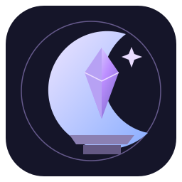

<h1 align="center">
   
  Luna Reforged
</h1>

<h4 align="center">辉月重铸 · 以月华淬炼锋芒</h4>

  
  
  
  
  

  <a href="docs/usage.md">安装与使用</a> ·
  <a href="docs/reforges.md">全部词缀</a> ·
  <a href="docs/custom-reforges.md">自定义词缀</a> ·
  <a href="docs/building.md">构建</a> ·
  <a href="docs/changelog.md">更新记录</a>

为武器、护甲和镐添加重铸词缀。在辉月重铸台消耗经验，获得攻击、防御、挖掘与特殊命中效果。

  

- 44 个词缀，包含点燃、缓慢、生命汲取和条件效果，名称使用渐变配色。
- 右槽留空时随机重铸，放入重铸石可指定词缀。
- 重铸前可查看效果与费用，成功后播放音效、粒子和界面动画。
- 保留装备原有名称、附魔和耐久，铁砧可正常改名。
- 服务端可调整经验费用、添加自定义词缀，配置会自动同步至客户端。

客户端和服务端均需另装 [Kotlin LunaCore 0.4.1](https://github.com/linlunaire/Kotlin-LunaCore/releases/tag/v0.4.1)，选择相同游戏版本与加载器；Fabric 还需对应版本的 Fabric API。安装要求见 [使用说明](docs/usage.md)，实测范围见 [验证记录](docs/verification.md)。

### 许可证

*采用 [GPL-3.0](LICENSE)。玩法基于 [Reforges](https://github.com/Auxilor/Reforges)，来源说明见 [NOTICE](NOTICE.md)。*
