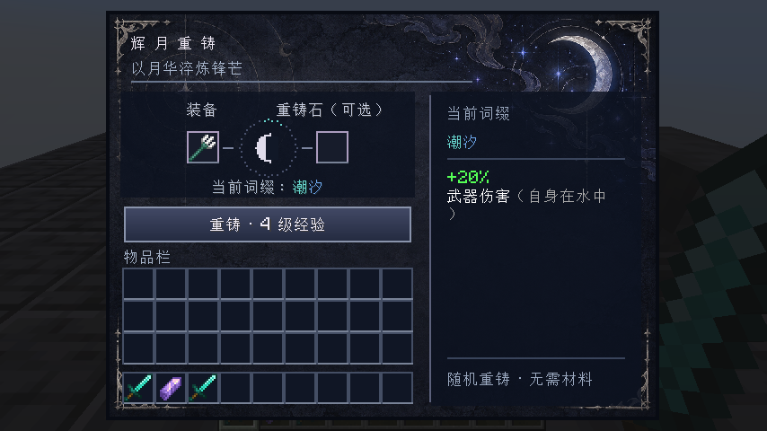
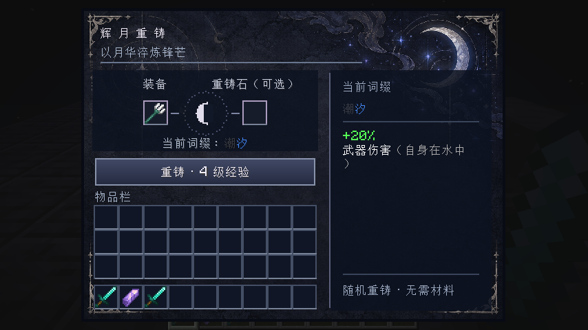
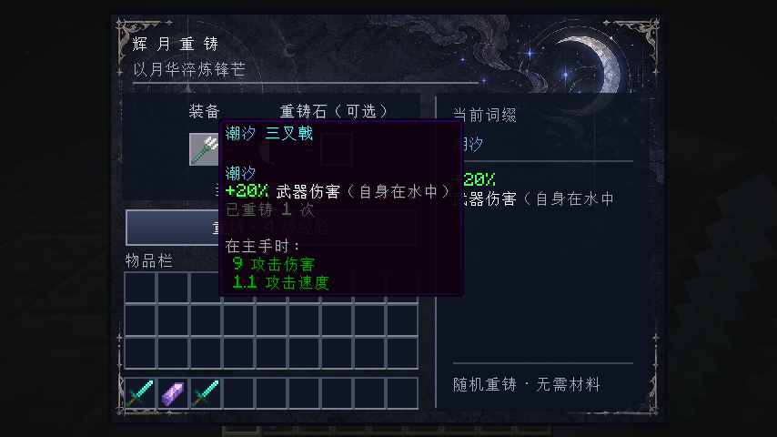
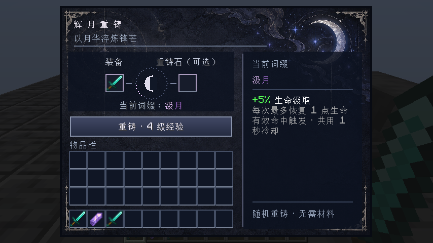
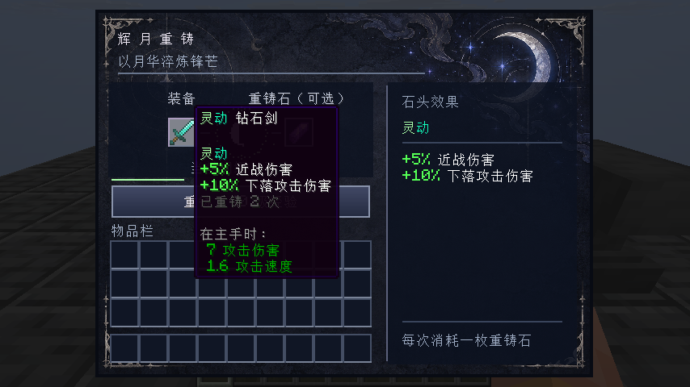
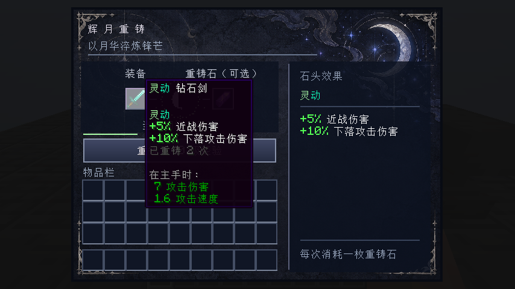

# 0.5.1 验证记录

Windows 本地验证，2026-10-17。两条版本线均使用 LunaCore 仓库构建的 0.4.1，辉月仓库不再编译或打包核心副本。

| 组合 | 构建与发行验包 | 独立服务端检查 | 客户端联机 |
| --- | --- | --- | --- |
| 26.2 Fabric | 通过 | 通过 | Vulkan；完整交易、渐变与资源重载通过 |
| 26.2 NeoForge | 通过 | 通过 | Vulkan；完整交易、渐变与资源重载通过 |
| 1.21.1 Fabric | 通过 | 通过 | OpenGL；完整交易、词缀预览通过 |
| 1.21.1 NeoForge | 通过 | 通过 | OpenGL；完整交易、词缀预览通过 |

四组均重新检查按钮随机重铸、定向石、自定义参数同步、铁砧改名与烬火、汲月、轻羽、潮汐预览，客户端和配套独立服务端正常退出。26.2 直接读取实际设备确认 Vulkan，在同一把三叉戟上检查潮汐首次显示、等待、悬停、移开及资源重载后的颜色一致；NeoForge 继续使用 `earlyWindowControl = false`。

测试中的辉月来自开发 source set，LunaCore 由 Gradle 从本地发行镜像解析；八个实例的 `mods/` 均无手工前置。1.21.1 NeoForge 的 Loom 会在依赖映射时移除 JarJar 元数据，因此开发启动另通过 `forgeRuntimeLibrary` 接入 stdlib 2.4.0。其全部 990 个类与 LunaCore 内置库逐字节一致，运行类路径仅有这一版 stdlib。这个开发配置不会把运行库打进辉月 JAR。

四个最终辉月发行 JAR 通过字节码目标、加载器依赖、Mixin 映射、44 个词缀资源和中英一致性检查；均不包含 LunaCore 类或嵌套运行库。完整源码与发行 ZIP 只收录辉月自身，安装时另下载对应 LunaCore。最终辉月 JAR 未额外装入第三方启动器整合包，以上联机结果对应所列开发实例。日志摘录与发行校验值见 [验证证据](evidence/validation.txt)。

---

# 0.5.0 验证记录

Windows 本地验证，2026-10-11。辉月重铸 0.5.0 配套 LunaCore 0.4.0；1.21.1 使用 0.4.0+mc1.21.1 兼容前置。两种加载器均要求新 ID `lunacore`，运行时代码包为 `io.github.linlunaire.lunacore`。

| 组合 | 最终构建与规则检查 | 独立服务端检查 | 真实客户端联机 | 最后配色调整后复查 |
| --- | --- | --- | --- | --- |
| 26.2 Fabric | 通过 | 通过 | 通过 | Vulkan、潮汐首次显示/悬停、资源重载通过 |
| 26.2 NeoForge | 通过 | 通过 | 通过 | 关闭早期加载窗口后，Vulkan 同组检查通过 |
| 1.21.1 Fabric | 通过 | 通过 | 通过 | 潮汐新旧截图、完整联机流程通过 |
| 1.21.1 NeoForge | 通过 | 通过 | 通过 | 重新构建与资源验包 |

运行中的辉月重铸来自对应开发 source set，前置使用最终发行 JAR。四组客户端/服务端共八份前置均与发行文件 SHA-256 一致。最终八个发行 JAR 分别经过核心构建检查或安装包检查；两套完整源码、Wrapper、许可证和 SHA-256 清单一并打包。最终辉月重铸 JAR 未额外装进第三方启动器整合包。

## 本次回归范围

- 核心：资源计量抛错、负值和溢出时的清理；清理异常保留原始错误；缓存复用、过期和幂等释放；队列容量、失败、关闭竞态；回调等待工作线程发布时不持有队列锁；交错有效/失效队列的线性清理、FIFO 与恰好一次释放；Java SAM/default 接口调用。
- 核心发行：新 ID、入口和 JVM 包名、独立执行实际产物，以及五种真实加载器 Kotlin 库选择情形（单独运行、FLK/KFF 同版本与较新 stdlib 共存）。兼容前置的三份策略源码与原生 LunaCore 逐字节一致。
- 服务端：44 个词缀与九类原版装备的资格匹配、空/堆叠物品拒绝；配置或自定义目录验证失败时保留整套原配置；合法重新加载生效。已有真实伤害入口、双手、投射物快照、冷却、菜单交易、铁砧、存档/网络组件检查全部重跑。
- 客户端：真实按钮随机重铸、定向石消耗、自定义参数同步、铁砧改名、烬火/汲月/轻羽预览；文本排版在物品、同 ID 自定义快照、价格、石头、等待状态、成功回执及显式失效后刷新，清空输入不保留旧说明。

## 分配与渲染边界

预热后测量当前线程分配量，四组最终联机中每 100,000 次不变展示状态刷新分别为 0 / 0 / 232 / 0 字节（按上表顺序）；对象身份检查确认名称、说明和排版结果复用。每 200,000 次有效词缀查询，26.2 两个加载器均为 8,096 字节，1.21.1 均为 7,904 字节，低于 16 KiB 的回归阈值。这些测量针对指定代码路径，不代表整个客户端或整帧零分配。

核心 2,048,000 次缓存访问和 1,000,000 次容量已满的任务提交均测得 0 字节分配；新建、首次扩容、接纳任务和生成新展示内容仍可分配。没有用这些结果推算 FPS/TPS 百分比或多人容量。四组合均有 OpenGL 联机记录，26.2 另完成以下 Vulkan 检查。

## 26.2 原生 Vulkan

2026-10-11，Windows 11、AMD Radeon RX 6900 XT、AMD 26.8.1 驱动。两个加载器的实际设备信息均为 `Vulkan / 1.4.315`。`-PpreviewBackend=vulkan` 从 `RenderSystem` 的运行中设备读取后端并断言；仅设置选项或看到客户端启动不算通过。

| 加载器 | Vulkan 配置 | 结果 |
| --- | --- | --- |
| Fabric Loader 0.19.3 / Fabric API 0.159.0+26.2 | `preferredGraphicsBackend:"vulkan"` | 通过 |
| NeoForge 26.2.0.75 / FML 11.0.16 | 同上；`config/fml.toml` 中 `earlyWindowControl = false` | 通过 |

两组均进入独立服务端，完成按钮随机重铸、定向石扣费、自定义词缀同步、铁砧改名、界面和纹理、重铸台粒子、渐变颜色及正常退出。资源重载完成后，等待加载遮罩消失再检查原屏幕并截图；名称、效果说明、字体与背景仍可正常显示。

NeoForge 默认早期窗口配置下复现了 `GLFW_NO_API` / `VK_ERROR_NATIVE_WINDOW_IN_USE_KHR`，发生于游戏创建窗口表面阶段。仅关闭测试实例的早期加载窗口并重新启用 Vulkan 后，同版本通过。处理方法与 [NeoForge #3230](https://github.com/neoforged/NeoForge/issues/3230) 一致；上游问题页列出的修复版本是 26.3.0.26-beta，不能将其当作 26.2.0.75 已修复。模组没有自动改写 FML 配置或插入窗口创建混入。



这些结果限于本机显卡、驱动和所列加载器；没有据此推算其他 GPU 的性能或任意整合包兼容性。

## 词缀配色

最后仅修改潮汐、引力、强韧、坚毅、背水、穿刺六处渐变端点，中英文一致；两份资源各 123 个键、44 个词缀、名称文本和数值均保留。四个消费者重新构建并验包通过，26.2 双加载器完成 Vulkan 画面检查，1.21.1 Fabric 完成 OpenGL 联机预览；1.21.1 NeoForge 的最终核心/玩法联机结果仍列于上表。

潮汐的旧灰蓝起点接近背景，新配色为 `#68D6CE → #6EA8ED`。实际 26.2 截图：

| 调整前 | 调整后 |
| --- | --- |
|  |  |

早期预览脚本为保存上面的旧色参考图，会先放入旧配色三叉戟，再于 2.5 秒后替换为新配色。这造成了首次放入为旧色、随后鼠标移过去时变为新色的展示问题。新增首次显示断言后，旧脚本以 `#373B44 / #4286F4` 失败；现已从两条版本线的预览中移除旧色插入和延时替换。

26.2 的回归检查直接读取实际屏幕已缓存的文字，不主动刷新或构建提示框。鼠标从首次放入前一直停在槽位外，首次显示和等待后的颜色均为 `#68D6CE / #6EA8ED`；随后悬停、移开和资源重载仍一致。检查同时确认物品没有被替换，避免再次把不同三叉戟的显示混在一起。



其他颜色与设计说明见 [视觉设计](visual-design.md)。可复现命令沿用下方记录中的构建与运行步骤；本轮日志摘录和前置校验值见 [验证证据](evidence/validation.txt)。

---

# 0.4.0 验证记录

Windows 本地验证，2026-10-01。完成全 Kotlin 转换后，重新清理、构建并验证以下四种组合。各组合使用对应 JDK、加载器和实际打包的 LunaCore 0.3.0 JAR；1.21.1 使用 0.3.0+mc1.21.1 兼容前置。

| 组合 | 构建与规则检查 | 独立服务端检查 | 真实客户端联机 |
| --- | --- | --- | --- |
| 26.2 Fabric | 通过 | 通过 | 按钮重铸、定向石、配置同步、铁砧、新词缀预览、截图 |
| 26.2 NeoForge | 通过 | 通过 | 按钮重铸、定向石、配置同步、铁砧、新词缀预览、截图 |
| 1.21.1 Fabric | 通过 | 通过 | 按钮重铸、定向石、配置同步、铁砧、新词缀预览、截图 |
| 1.21.1 NeoForge | 通过 | 通过 | 按钮重铸、定向石、配置同步、铁砧、新词缀预览、截图 |

运行中的辉月重铸代码来自对应开发 source set，前置使用真实 JAR。最终发行 JAR 另经 Kotlin 工具 `verifyArtifacts` 检查：四个消费者、两个兼容前置、Java 字节码目标、加载器元数据、Mixin 的 Kotlin 元数据和映射目标、渐变资源、44 个词缀及中英键一致性。消费者不包含第二份 Kotlin 或 LunaCore。联机验证时，八个前置 JAR（四组客户端/服务端）与发行文件的 SHA-256 一致。

九个 Java 接口与混入类已转换为 Kotlin，构建脚本改为 Kotlin DSL；四个辅助工具也已迁移。1.21.1 Fabric 使用 Loom 直接映射字节码中的混入目标，验包检查实际注解中的 intermediary 方法名和铁砧重定向描述符。清理旧产物后，两套构建、四个独立服务端检查和四组真实客户端联机均通过。

资源生成器重新生成的 36 个 JSON 与转换前逐字一致，只统一了换行格式。123 个中英翻译键、44 个渐变词缀、方块几何和两版配方均保留。工具分别在 JDK 25 / Gradle 9.5.1 与 JDK 21 / Gradle 8.14.5 下编译和验包通过。

这次验证没有将最终辉月重铸 JAR 安装进第三方启动器整合包；开发环境联机不等同于任意整合包兼容。

## 机制与描述

服务端检查确认 44 个内置词缀均有说明；增益以绿色数值开头，代价以红色数值开头，不显示缺失的翻译键。数值由效果参数生成，右侧预览和物品提示共用内容。原 16 个名称的渐变端点保持不变。

实际调用原版伤害入口验证了：

- 无敌目标拒绝的命中不点燃、不消耗触发冷却；正常命中点燃 3 秒。
- 同一攻击者立刻换目标仍受冷却限制，时间达到边界后冷却到期。
- 霜凝箭矢保留发射武器快照，射手换手后仍施加持续 40 tick 的缓慢 I。
- 汲月按实际生命/吸收生命损失治疗，连续攻击受冷却限制。
- 终结的 30% 目标生命边界，以及长星 12 格距离边界。
- 轻羽、烬佑、壁垒只影响各自的摔落、火焰、投射物伤害，其他来源和虚空不受影响。

同时重跑旧机制检查：存档与网络组件往返、名称/耐久保留、原生铁砧改名、旧属性迁移、严格配置校验、空槽随机重铸、定向石固定价格与重复施加、扣费与回执、旧请求拒绝、双手效果、下落攻击判定、环境减伤、箭矢快照和恰好一次的击杀经验。

规则检查包括 44 个唯一 ID、7 个镐词缀、目标匹配、价格上限、原 16 个 ID、均匀抽取和成功动画只随服务端回执播放。

## 客户端与画面

四个客户端均通过真实按钮回调发出重铸请求，检查服务端返回的物品与回执。随后验证定向石、自定义渐变同步、铁砧输入原名与结果改名，以及烬火、汲月、轻羽的实际预览。

1.21.1 的预览还检查了实际鼠标悬浮坐标。一次早期运行因服务端等待客户端过久而触发夹具超时；已将连接等待和活动场景分别计时，重新跑完全部步骤。截图中的物品提示框和新面板均在游戏中实际渲染。

最后一轮仅调整了汲月说明的换行，将治疗上限另列为灰色说明；四个产物重新构建，并再次用 26.2 Fabric 检查画面与联机流程。该调整没有改变战斗逻辑。







截图直接来自预览客户端，没有修改图片内容。测试夹具手动触发一次与真实交易相同的方块事件，以捕获重铸台粒子。图片不是 FPS 或网络性能基准。

## 前置与许可证

LunaCore 主项目通过 `build`、最终 JAR 运行测试、真实加载器依赖解析测试和 Maven POM 生成检查。Fabric / NeoForge 元数据均声明 LGPL-3.0-or-later。JAR 内的 `LICENSE`、`licenses/GPL-3.0.txt`、`NOTICE.md` 与项目文件逐字节相同。

兼容前置的三个策略源文件与 LunaCore 主项目当前源码一致。两份完整源码包、wrapper、构建脚本、许可证、例子、截图和校验清单随发行包提供。

[成功进程与检查证据](evidence/validation.txt)

## 复现

使用可丢弃的 `versions/<版本>/<加载器>/run/` 测试实例。自 0.5.1 起，Gradle 会自动解析并加载对应 LunaCore；先移走测试实例 `mods/` 中手工放置的旧前置，避免重复安装。测试会在 `(0,100,0)` 放置/移除方块并创建物品与生物，请勿指向真实存档。实例使用本机回环地址、离线模式，并按 Minecraft 要求处理 EULA。

```powershell
# 26.2 使用 JDK 25，1.21.1 使用 JDK 21
.\versions\26.2\gradlew.bat -p versions/26.2 :fabric:runServer :neoforge:runServer -Pverify --console=plain
.\versions\1.21.1\gradlew.bat -p versions/1.21.1 :fabric:runServer :neoforge:runServer -Pverify --console=plain
```

每个服务端必须同时出现 `LUNA_REFORGED_SERVER_CHECKS_PASSED` 和成功退出。只看到 `Done` 或退出码 0 不够，夹具失败会输出 `LUNA_REFORGED_SERVER_CHECKS_FAILED`。

客户端在独立的 `run/client-preview/` 目录运行，避免 Windows 文件锁冲突。前置由 Gradle 的运行依赖提供，服务端和客户端的 `mods/` 均无需再放 LunaCore。依次运行对应加载器的 `runServer -Ppreview`、`runClient -Ppreview`。固定端口为 26.2 Fabric 25760、26.2 NeoForge 25761、1.21.1 Fabric 25762、1.21.1 NeoForge 25763。`server.properties` 必须匹配端口。可用 `options.txt` 设置 `lang:zh_cn`、`guiScale:2`、`tutorialStep:none`、`particles:0`。

没有 `-Ppreview` 时不注册预览 tick 监听。预览完成后客户端退出，服务端随断开退出。截图保存在客户端的 `screenshots/` 下。

## 范围限制

仍需长时间游玩和整合包测试，尤其是拖拽分配、数字键换位、满背包、菜单中断线/死亡，以及战斗模组的混入和属性交互。概率效果、全部天气/昼夜场景没有穷尽测试。CI 按两个游戏版本分别执行构建和 Kotlin 验包，运行结果见 [GitHub Actions](https://github.com/linlunaire/Luna-Reforged/actions)。

本机日志偶有 Windows 性能计数器警告和开发离线档案 HTTP 401。成功运行没有遗留的辉月重铸注册、资源、菜单或混入错误。
